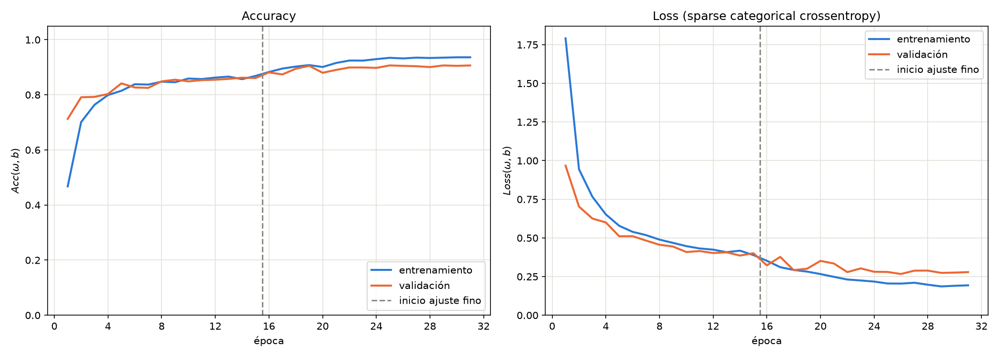
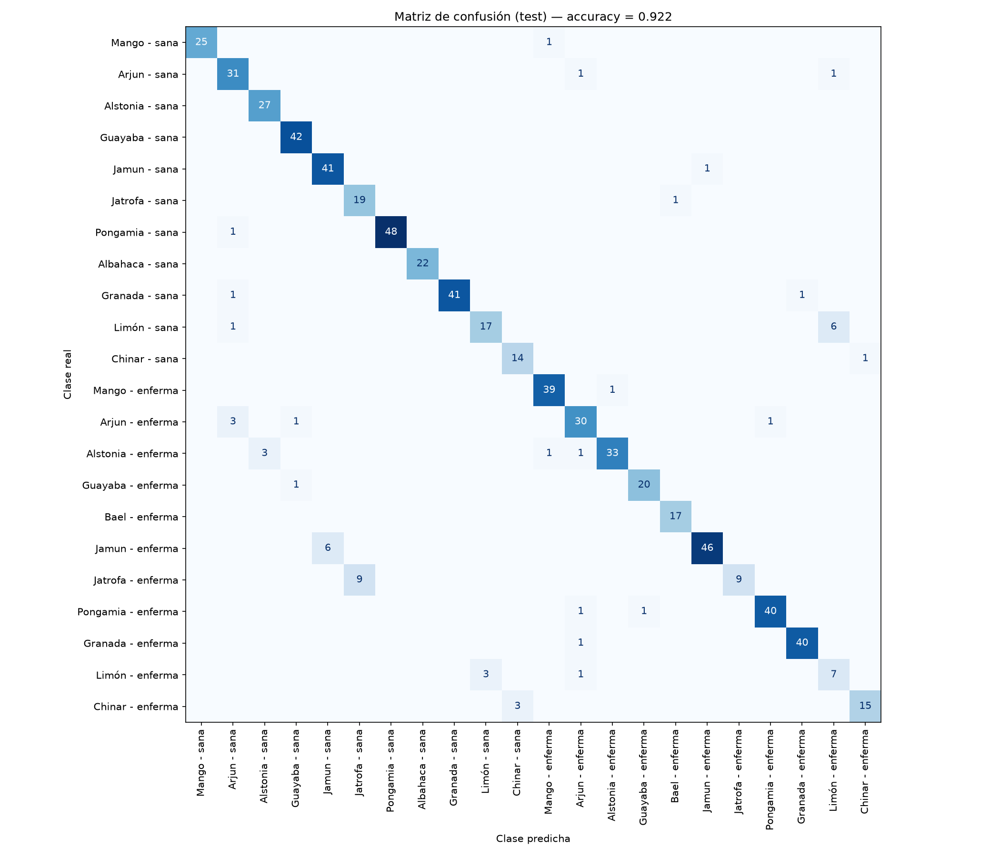
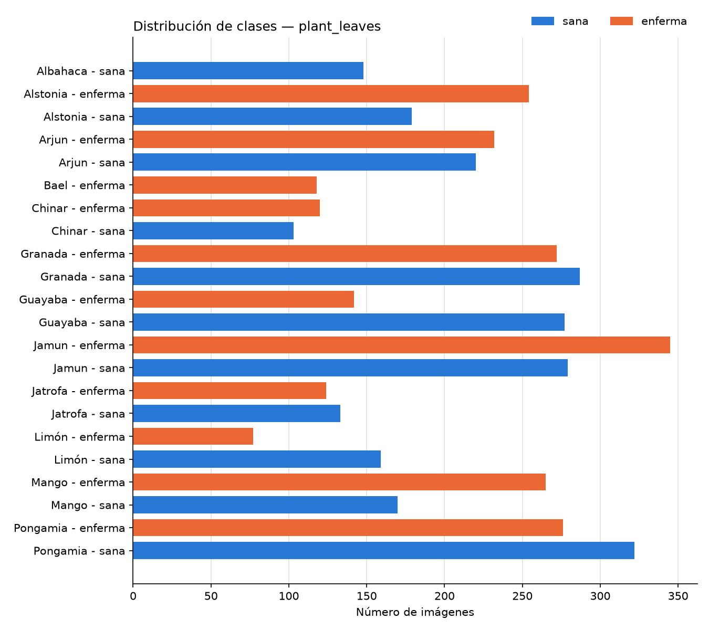

# 🍃 Enfermedades en hojas de plantas con transferencia de aprendizaje

Clasificador de **22 clases** (12 especies de plantas, hoja sana o enferma) entrenado con
**transferencia de aprendizaje sobre MobileNetV2** en el clúster **YUCA** (SLURM + conda) y
usado desde el **celular** con TensorFlow.js.

- 📝 Artículo en Medium: [Detectando enfermedades en hojas de plantas con transferencia de aprendizaje: del clúster al celular](https://medium.com/@mahn10/detectando-enfermedades-en-hojas-de-plantas-con-transferencia-de-aprendizaje-del-cl%C3%BAster-al-d0b44d75a99a)
- 🎥 Vídeo de la aplicación en el celular: [Google Drive](https://drive.google.com/file/d/1M7FD8dq1A1JCE1BPuLeUljMLWLzjgssk/view?usp=sharing)

Manuel Alejandro Heredia Nogales — Redes Neuronales 2026-2

---

## Resultados

| Conjunto | Accuracy | Top-3 accuracy | Loss |
|---|---|---|---|
| Entrenamiento | 95.3 % | 99.9 % | 0.136 |
| Validación | 90.5 % | 99.7 % | 0.267 |
| **Prueba** (676 imágenes) | **92.2 %** | **99.9 %** | **0.215** |

Entrenado en YUCA con 16 CPUs: el script completo tardó 6.6 minutos. Las clases más difíciles son
*Limón - enferma* (f1 = 0.56; es la clase más pequeña, con 11 imágenes de prueba) y
*Jatrofa - enferma* (recall = 0.50).

De los 53 errores en prueba, 39 confunden la versión sana y la enferma de la misma especie, así que la
especie se identifica correctamente en el 97.9 % de las imágenes. El error más común es clasificar
una hoja enferma como sana (28 casos, contra 11 en sentido contrario).

Los valores salen de [`resultados/reporte_clasificacion.txt`](resultados/reporte_clasificacion.txt),
que también incluye precision, recall y f1 por clase.

**Accuracy y loss** (la línea punteada marca el inicio del ajuste fino)



**Matriz de confusión** (conjunto de prueba)



---

## Dataset

[`plant_leaves`](https://www.tensorflow.org/datasets/catalog/plant_leaves): 4502 fotografías
de 6000×4000 px (6.8 GB) de hojas de mango, arjun, alstonia, guayaba, bael, jamun, jatrofa,
pongamia, albahaca, granada, limón y chinar, cada una fotografiada sobre un fondo oscuro.

| | |
|---|---|
| Clases | 22 (11 sanas, 11 enfermas) |
| Imágenes por clase | de 77 (limón enferma) a 345 (jamun enferma) |
| División | 70 % entrenamiento, 15 % validación, 15 % prueba (estratificada) |



> Chouhan, S. S., Kaul, A., Singh, U. P., Jain, S. (2019). *A Database of Leaf Images: Practice
> towards Plant Conservation with Plant Pathology*. Mendeley Data, V1.
> [doi:10.17632/hb74ynkjcn.1](https://doi.org/10.17632/hb74ynkjcn.1) — licencia CC BY 4.0.

---

## Método

1. **Pipeline de datos (`tf.data`).** Cada JPEG se decodifica con `decode_jpeg(ratio=8)`: libjpeg
   lo reduce a 750×500 al decodificar, sin pasar por los 24 megapíxeles. Luego se redimensiona a
   224×224 y se guarda en memoria con `cache()`, así que solo la primera época lee los 6.8 GB.
2. **Aumento de datos** en el pipeline: volteos, rotación, zoom, contraste y brillo. No va dentro
   del modelo, para que el modelo exportado a TensorFlow.js tenga solo capas de inferencia.
3. **Clases ponderadas** (`compute_class_weight('balanced')`), porque la clase más grande es 4.5
   veces la más pequeña.
4. **Modelo.** `Rescaling` a [-1, 1], luego MobileNetV2 (ImageNet, sin la capa superior), luego
   `GlobalAveragePooling2D`, `Dropout(0.2)` y `Dense(22, softmax)`.
5. **Fase 1, extracción de características:** base congelada, Adam con lr = 1e-3, hasta 15 épocas.
6. **Fase 2, ajuste fino:** se descongela MobileNetV2 desde la capa 100 (de 154). Adam con
   lr = 1e-5, hasta 20 épocas. Las BatchNormalization se quedan en modo inferencia
   (`training=False`).
7. `EarlyStopping`, `ReduceLROnPlateau` y `ModelCheckpoint` (se conserva la época con menor
   `val_loss`).
8. Exportación a `.h5` y conversión con `tensorflowjs_converter` para la aplicación web.

---

## Estructura

```
├── leafs_plants.py          # entrenamiento (archivo fuente principal)
├── descargar_datos.py       # descarga del dataset desde Mendeley Data
├── leafs_plants.slrm        # trabajo SLURM para YUCA
├── plantas_tl.yml           # ambiente conda exportado en YUCA
├── resultados/              # gráficas, matriz de confusión y reporte
├── modelo/modelo_plantas.h5 # modelo entrenado (Keras 2.15)
└── app/                     # aplicación para el celular
    ├── index.html
    ├── clases.json
    ├── muestras.json        # imágenes de prueba con su clase real
    ├── muestras/            # una imagen de prueba por clase (no vistas al entrenar)
    └── modelo/              # modelo en formato TensorFlow.js
```

---

## Cómo reproducirlo en YUCA

**1. Subir el proyecto** (desde tu computadora). `CARPETA` es la carpeta de este proyecto:
`Tareas/Clasificacion con TL` en el repositorio del curso, o `Clasificacion-enfermedades-plantas`
si clonaste el repositorio del proyecto.

```bash
CARPETA="Tareas/Clasificacion con TL"      # o "Clasificacion-enfermedades-plantas"
scp -r "$CARPETA" estudiante_09@148.225.111.153:~/ClasificacionTL
ssh estudiante_09@148.225.111.153
cd ~/ClasificacionTL
```

**2. Crear el ambiente conda** (una sola vez):

```bash
module load conda
conda create -n plantas_tl python=3.11 -y
source activate plantas_tl
pip install "tensorflow==2.15.0" "tensorflowjs==4.22.0" "setuptools<81" scikit-learn matplotlib
```

- TensorFlow 2.15 (Keras 2) es la versión que funciona con `tensorflowjs_converter`.
- `setuptools<81` hace falta porque `tensorflow_hub` (dependencia de tensorflowjs) todavía usa
  `pkg_resources`.

También puedes recrear el ambiente exacto a partir del archivo exportado:
`conda env create -f plantas_tl.yml`.

**3. Enviar el trabajo:**

```bash
sbatch leafs_plants.slrm
squeue -u estudiante_09          # ver el estado
tail -f slurm-<IDJOB>.out        # ver el avance
```

El trabajo hace cuatro cosas en orden:

1. Descarga las imágenes. Tarda unos 15 minutos y se salta las que ya existen.
2. Entrena el modelo.
3. Convierte el modelo a TensorFlow.js en `app/modelo/`.
4. Exporta el ambiente con `conda env export -n plantas_tl > plantas_tl.yml`.

- Si el servidor no puede descargar las imágenes (sin internet, o con un error
  `CERTIFICATE_VERIFY_FAILED` porque la red intercepta HTTPS), ejecuta `python descargar_datos.py`
  en tu computadora y sube la carpeta `datos/` al servidor. El `.slrm` solo descarga si faltan
  imágenes.
- El `.slrm` pide 16 CPUs y 16 GB de RAM. Para ver el tamaño de los nodos usa
  `sinfo -p cpu -N -o "%N %c %m %C %e"`. Al terminar, `seff <IDJOB>` o
  `sacct -j <IDJOB> --format=JobID,Elapsed,AllocCPUS,TotalCPU,MaxRSS` muestran cuánto se usó de verdad,
  para ajustar los recursos sin acaparar el clúster.
- Uso real medido con `sacct` (trabajo 2203158): 7 min 06 s, 5.2 GB de RAM como máximo y ~63 % de
  eficiencia de CPU. Para repetirlo bastan `--mem=8G` y `--time=0:30:00`.

**4. Descargar los resultados** (en YUCA y luego en tu computadora):

```bash
# en YUCA
tar czf resultados_tl.tgz resultados modelo/modelo_plantas.h5 app plantas_tl.yml slurm-*.out
# en tu computadora (con la misma CARPETA del paso 1)
CARPETA="Tareas/Clasificacion con TL"      # o "Clasificacion-enfermedades-plantas"
scp estudiante_09@148.225.111.153:~/ClasificacionTL/resultados_tl.tgz .
tar xzf resultados_tl.tgz -C "$CARPETA"
```

---

## Aplicación para el celular

```bash
cd app
python -m http.server 8000          # luego abre localhost:8000/index.html
ngrok http 8000                     # en otra terminal; abre la liga https://... en el celular
```

La cámara del navegador solo funciona con HTTPS, y ngrok lo proporciona.

En la aplicación:

- **Cámara:** clasifica en vivo lo que está dentro del recuadro.
- **Subir foto:** clasifica una imagen de la galería.
- **Muestra de prueba:** carga una imagen del conjunto de prueba y muestra su clase real.

Para mejores resultados, fotografía una sola hoja completa sobre un fondo oscuro (cartulina o
tela negra), como en las fotos del dataset. El recuadro tiene la misma proporción 3:2 de esas fotos.
